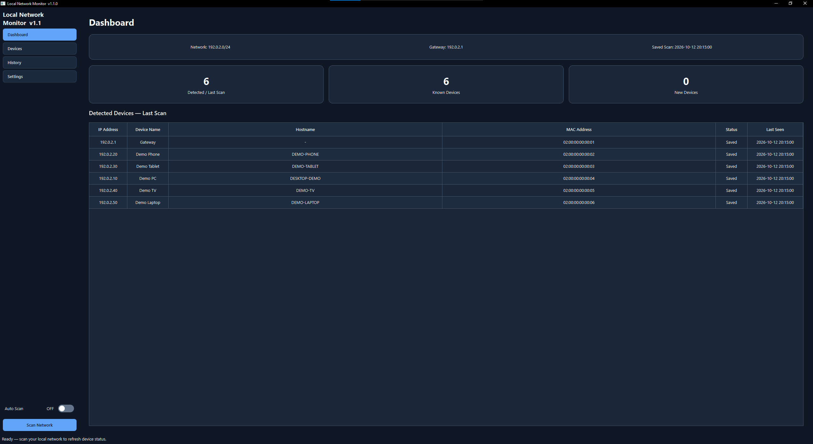
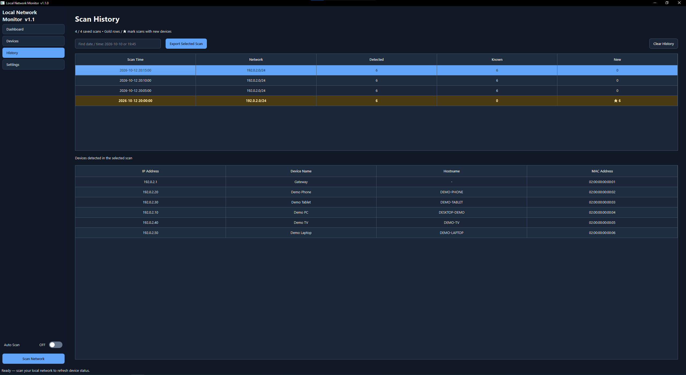
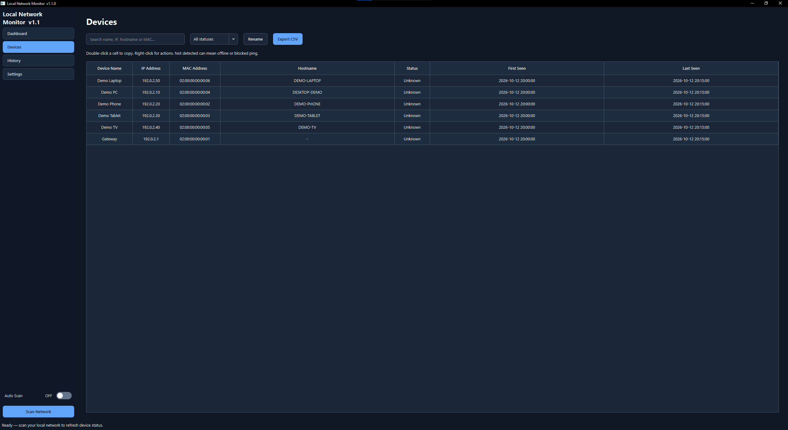

# Local Network Monitor

**Local Network Monitor v1.1.0** is a Windows desktop application for monitoring devices connected to a local network.

The project was created to practice Python, desktop GUI development, local-network concepts, background scanning, persistent storage, scan history, settings management, and application testing.

## Screenshots

### Dashboard



### Scan History



### Devices



### Settings


## Features

### Dashboard
- Detect the active IPv4 network and default gateway
- Scan devices on the local network
- Display detected, known, and new device counts
- Show IP address, device name, hostname, MAC address, status, and last-seen time
- Manual network scan
- Scan progress
- Cancel an active scan
- Auto Scan switch

### Devices
- View remembered devices
- Search by device name, IP address, hostname, or MAC address
- Filter devices by status
- Rename devices
- Keep custom device names between sessions
- Export visible device data to CSV
- Double-click a cell to copy its value
- Right-click context menu for copy, rename, and export actions

### Scan History
- Store scan history locally
- Search scans by date or time
- View devices detected in a selected scan
- Highlight scans where new devices were detected
- Export selected scan data
- Clear scan history while keeping remembered devices

### Settings
- Configure Auto Scan interval
- Configure ping timeout
- Enable or disable hostname lookup
- Configure scan-history limit
- Light theme
- Dark theme
- Same as device theme
- Custom theme colors
- Open the local application data folder

## How It Works

1. The application detects the active IPv4 network and default gateway.
2. It scans hosts on the local network.
3. Detected devices are compared with previously saved devices.
4. New devices are identified and recorded.
5. Known devices have their latest information updated.
6. Scan results are stored in local history.
7. The GUI is updated while the network scan runs in the background.

The application is intended for networks that the user owns or is authorized to inspect.

## Technologies

- Python
- PySide6 / Qt
- Qt Designer
- Windows networking tools
- JSON local storage
- CSV export

## Project Structure

```text
local-network-monitor/
├── main.py
├── network.py
├── storage.py
├── appearance.py
├── main_window.ui
├── README.md
└── screenshots/
    ├── dashboard.png
    ├── history.png
    ├── devices.png
    └── settings.png